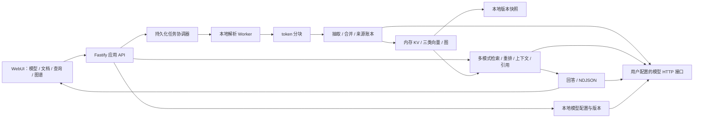

# LightRAG 代码转移实现方案

## 1. 目标与当前状态

在 `czhcc/TsLightRAG` 中，以 TypeScript 实现 LightRAG 的本地文档知识库应用：本地解析文档、抽取实体和关系、建立文件持久化的内存索引，提供图谱增强检索、带引用的生成式问答，以及模型配置界面。

这是一项**限定范围的功能迁移**，不是 Python 逐行翻译，也不是对上游所有接口、文件格式或检索质量作完全兼容承诺。目标交付物是一个可启动的 Web 应用及其服务端，不发布 SDK。

- 编制日期：2026-10-15。
- 目标仓库：<https://github.com/czhcc/TsLightRAG>。
- 分析来源：<https://github.com/HKUDS/LightRAG>。
- 固定上游提交：`aaebfe1bb8d55deb6a4304d357a3bf4c92fcd40a`。
- 上游提交时间：2026-10-14T22:55:37+08:00；源码版本字段为 `1.5.8`，API 版本字段为 `0347`。以提交 SHA 为分析基准，不以会变化的默认分支或版本字段单独定位。
- 当前 S01 工程、S02 存储与 S03 模型配置/HTTP 协议、S04 本地解析/分块和 S05 文档/持久化任务已完成，见 [S01](S01_VALIDATION.md)、[S02](S02_VALIDATION.md)、[S03](S03_VALIDATION.md)、[S04](S04_VALIDATION.md) 和 [S05 验证记录](S05_VALIDATION.md)。索引、图谱算法和其他业务接口仍为**待实施约定**，不能以基座通过代替功能验收。
- 配套文档：[LightRAG代码转移实施步骤](LightRAG代码转移实施步骤.md)。

## 2. 用户要求与迁移边界

### 2.1 必须满足

| 要求 | 实现约定 |
|---|---|
| 使用 TypeScript | 服务端、领域逻辑、解析调度和 WebUI 使用 TypeScript；可使用本地 JavaScript 库，不依赖 Python 服务或 Python 子进程 |
| 仅本地存储 | KV、向量、图、文档状态均以进程内数据结构服务读写，使用本地文件恢复；不引入 PostgreSQL、SQLite、Redis、Neo4j、Milvus 等数据库 |
| 所有文档解析在本地执行 | 服务端本地 Worker 执行解码、PDF/Office/HTML 解析；不调用 MinerU、Docling 或任何远程文件解析接口 |
| 保留外部模型调用 | 支持 OpenAI-compatible 文本与 embedding HTTP 接口、标准 Cohere/Jina-compatible rerank HTTP 接口；可连接符合这些协议的本地模型服务 |
| 不需要环境变量 | 业务配置由默认值、启动参数和本地配置文件提供；模型在 WebUI 配置，不要求 `.env`，不从 `process.env` 读取模型、密钥、存储或端口配置 |
| 界面配置不同模型地址 | 文本生成、抽取、关键词、向量、重排可独立绑定模型配置；抽取和关键词默认复用文本模型，向量单独必填，重排可禁用 |
| 不提供 SDK | 只交付应用内部模块和应用 HTTP API，不发布 npm 客户端、Python SDK、LangChain 插件等集成产品 |
| 生成并执行测试 | 每个实施阶段必须同时交付有意义的自动化测试；最终执行单元、协议、文件存储、HTTP 集成和浏览器端到端测试，输出可审查的实际报告 |

“本地解析”不等于“全部推理离线”：解析器不联网；完成解析后的文本片段、查询和检索上下文，可发送到用户明确配置的模型接口。界面必须说明这些数据流；不将上传的二进制文件发送给模型提供商。

### 2.2 首版功能范围

| 编号 | 功能 | 首版承诺 |
|---|---|---|
| F01 | 模型配置 | 模型配置增改、角色绑定、连接测试、密钥遮蔽、重启恢复和配置版本控制 |
| F02 | 文档管理 | 上传文件、粘贴文本、列表、状态、详情、删除、手动重试、重新索引 |
| F03 | 本地解析 | UTF-8 TXT/Markdown/HTML/CSV/JSON、带文本层 PDF、DOCX、XLSX、PPTX；提供格式能力表和解析警告 |
| F04 | 分块 | token 窗口、可配置重叠、保留标题/页码等来源定位；默认先实现固定 token 分块 |
| F05 | 图谱抽取 | JSON 实体/关系抽取、有限补充抽取、规范化、合并、去重、来源追踪和必要的描述摘要 |
| F06 | 本地索引 | 文档/块 KV、实体/关系/块三类向量、无向知识图谱、文档任务状态 |
| F07 | 检索 | `naive`、`local`、`global`、`hybrid`、`mix`，默认 `mix`，有可验证的分支差异 |
| F08 | 重排 | 可选启用、分数与结果校验、失败策略、候选截断和 token 预算 |
| F09 | 生成式问答 | 非流式和流式回答、多轮历史输入、引用列表、检索数据和最终上下文查看 |
| F10 | 图谱界面 | 节点/边搜索、限量子图、邻居展开、属性和来源查看，不包含手工改图 |
| F11 | 来源一致性 | 同文档去重、文档贡献账本、共享实体/关系删除后重建、索引与缓存失效 |
| F12 | 恢复 | 文件校验、原子快照、单写者互斥、重启恢复、异常任务识别和显式重试 |
| F13 | 测试与运行 | 无真实模型密钥的离线测试；构建、类型检查、应用启动和持久化重启验收 |

### 2.3 明确不在首版范围内

- PostgreSQL 及其他外部数据库、远程解析服务、分布式任务队列、集群、多进程共享写入。
- Python/TypeScript SDK 发布、Ollama 服务端仿真接口、上游完整 HTTP API 兼容、Kubernetes/多云部署。
- 多租户、账号/RBAC、SSO、多知识库管理界面。首版只有一个固定 `default` 工作区。
- 图谱节点/边手工创建、改名、合并、删除管理；可以通过删除文档影响图谱。
- 扫描件 OCR、图片/音频/视频理解、远程图片下载、公式语义识别、上游 DOCX smart heading NLP、完整多模态 sidecar。
- `.doc/.xls/.ppt` 旧 Office、密码保护文档、复杂版面/表格跨页精确还原、网页抓取、自动目录扫描。
- 语义向量分块、完整段落语义分块、任意第三方解析器/存储插件、在线质量排行榜。
- 直接加载 Python LightRAG 的 JSON/GraphML/nano-vectordb 文件。首版重新导入原始文档；文件格式兼容另立任务。
- 外部模型本身的部署、训练、自动下载模型权重，以及所有供应商原生专用协议。

后续需求可以扩展，但不能用“预留接口”替代首版承诺的真实实现。

## 3. 上游源码结构与实现分析

所有源码链接固定到上述提交。读取上游 `AGENTS.md`、`pyproject.toml`、核心实现及测试目录后，得到以下映射。

| 上游位置 | 实际职责与实现要点 | TypeScript 迁移方式 |
|---|---|---|
| [`lightrag/lightrag.py`](https://github.com/HKUDS/LightRAG/blob/aaebfe1bb8d55deb6a4304d357a3bf4c92fcd40a/lightrag/lightrag.py) | `LightRAG` 编排入口，组合角色、流水线、迁移 mixin；实例化所有存储命名空间；负责插入、查询、删除和收尾 | 迁入应用服务及内部领域模块，不暴露 SDK 类 |
| [`lightrag/pipeline.py`](https://github.com/HKUDS/LightRAG/blob/aaebfe1bb8d55deb6a4304d357a3bf4c92fcd40a/lightrag/pipeline.py) | 持久化文档状态、排队、解析/分析/处理 worker、取消、失败重试与恢复 | 单进程持久化任务状态机；Worker 只做解析，领域提交统一由主进程完成 |
| [`lightrag/operate.py`](https://github.com/HKUDS/LightRAG/blob/aaebfe1bb8d55deb6a4304d357a3bf4c92fcd40a/lightrag/operate.py) | `extract_entities`、节点/边合并、`kg_query`、`naive_query`；检索上下文采用 search → truncate → merge chunks → build context | 拆成 extraction、indexing、retrieval、context、generation 模块，保留可测的中间结果 |
| [`lightrag/prompt.py`](https://github.com/HKUDS/LightRAG/blob/aaebfe1bb8d55deb6a4304d357a3bf4c92fcd40a/lightrag/prompt.py) | 实体关系抽取的 tuple/JSON 提示词、补充抽取、摘要、关键词、回答和无证据回复 | 首版选 JSON 抽取协议，移植提示词语义并记录模板版本；不实现 tuple 兼容解析 |
| [`lightrag/chunker/`](https://github.com/HKUDS/LightRAG/tree/aaebfe1bb8d55deb6a4304d357a3bf4c92fcd40a/lightrag/chunker) | 固定 token、递归、向量语义、段落语义等策略；`token_size.py` 记录 source span | 首版固定 token 与块位置映射，其他策略明确延期 |
| [`lightrag/base.py`](https://github.com/HKUDS/LightRAG/blob/aaebfe1bb8d55deb6a4304d357a3bf4c92fcd40a/lightrag/base.py) | QueryParam、QueryResult、KV/向量/图/状态接口、DocStatus | 使用 TypeScript 类型和运行时 schema；不照搬环境变量默认值 |
| [`lightrag/kg/`](https://github.com/HKUDS/LightRAG/tree/aaebfe1bb8d55deb6a4304d357a3bf4c92fcd40a/lightrag/kg) | 默认 `JsonKVStorage`、`NanoVectorDBStorage`、`NetworkXStorage`、`JsonDocStatusStorage`，另有多种外部后端 | 只实现默认后端的功能语义，不移植外部后端注册表或 Python 库 |
| [`lightrag/file_atomic.py`](https://github.com/HKUDS/LightRAG/blob/aaebfe1bb8d55deb6a4304d357a3bf4c92fcd40a/lightrag/file_atomic.py) 与 `docs/design/` | 原子文件替换、共享命名空间提交、单写者、故障恢复、删除贡献追踪契约 | 采纳不丢已提交数据、故障显式化原则；以单进程整代快照简化跨存储提交 |
| [`lightrag/parser/`](https://github.com/HKUDS/LightRAG/tree/aaebfe1bb8d55deb6a4304d357a3bf4c92fcd40a/lightrag/parser) | native DOCX/Markdown、legacy 本地 PDF/Office/文本、external MinerU/Docling HTTP 解析 | 全部替换成本地 JS/TS 解析；不迁入 external HTTP 分支 |
| [`lightrag/llm_roles.py`](https://github.com/HKUDS/LightRAG/blob/aaebfe1bb8d55deb6a4304d357a3bf4c92fcd40a/lightrag/llm_roles.py) 与 `llm/` | extract、keyword、query、vlm 角色绑定，异步限流、缓存和供应商适配 | 保留前三种文本角色和独立 embedding/rerank 配置；不实现 vlm |
| [`lightrag/rerank.py`](https://github.com/HKUDS/LightRAG/blob/aaebfe1bb8d55deb6a4304d357a3bf4c92fcd40a/lightrag/rerank.py) | 标准 Jina/Cohere 与其他协议适配，长文切片及结果规范化 | 首版标准协议；严格校验 index/score，限制模型输入长度 |
| [`lightrag/api/routers/`](https://github.com/HKUDS/LightRAG/tree/aaebfe1bb8d55deb6a4304d357a3bf4c92fcd40a/lightrag/api/routers) | 文档、查询、图谱接口；`query_routes.py` 的 `/query/stream` 对外实际使用 NDJSON | Fastify 应用 API；保留 NDJSON 传输思想，不宣称与全部上游路由兼容 |
| [`lightrag_webui/src/`](https://github.com/HKUDS/LightRAG/tree/aaebfe1bb8d55deb6a4304d357a3bf4c92fcd40a/lightrag_webui/src) | 已是 React/TypeScript，文档管理、RetrievalView、GraphViewer，Graphology/Sigma 图显示 | 选择性复用界面组织、交互和工具函数，重新接入目标 API；新增完整模型配置页 |
| [`tests/`](https://github.com/HKUDS/LightRAG/tree/aaebfe1bb8d55deb6a4304d357a3bf4c92fcd40a/tests) 与 WebUI `*.test.*` | 抽取、存储、管线、删除、模型、API、安全、UI 回归 | 把范围内行为整理成 TS 对应测试和固定夹具；不是直接执行所有 Python 用例 |

### 3.1 索引链路

上游并非仅“文本 → embedding”。它维护 `full_docs`、`text_chunks`、`full_entities`、`full_relations`、`entity_chunks`、`relation_chunks`、模型缓存、文档状态，另外维护实体、关系、文本块三个向量空间和一个实体关系图。贡献账本与反向引用是重试、删除和恢复的关键。

目标链路：上传落盘 → 本地解析为统一内容块 → token 分块 → 文本块向量化 → 文本模型抽取实体/关系 → 合并和摘要 → 实体/关系向量化 → 校验引用 → 一次发布可查询快照 → 文档标记成功。

### 3.2 查询链路

| 模式 | 候选来源 | 必须体现的行为 |
|---|---|---|
| `naive` | 查询 embedding → 文本块向量检索 | 不执行关键词抽取、不访问实体/关系图；后续重排与引用仍可用 |
| `local` | 低层关键词 embedding → 实体向量 → 实体及邻接关系 → 关联块 | 用实体相关性回答对象细节 |
| `global` | 高层关键词 embedding → 关系向量 → 关系及端点实体 → 关联块 | 从关系侧进入图谱；不是随意遍历整张图 |
| `hybrid` | local 与 global 合并 | 图谱候选去重、稳定排序和来源块合并；不额外检索整个块向量库 |
| `mix` | hybrid + 查询对文本块的直接向量召回 | 图谱和独立文本召回融合，默认模式 |

检索后处理：实体/关系预算截断 → 从保留的图谱候选挑选证据块 → 与直接块召回去重融合 → 可选重排 → 总上下文预算 → 构造回答提示词及引用 → 文本模型生成。详细排序规则以固定数据夹具验收，而不是声称任意模型下逐字等价。

`conversationHistory` 作为生成历史，不直接拼进向量查询，遵循上游 QueryParam 的基本语义。首版不做独立历史问题改写。

### 3.3 默认存储的适用边界

上游默认存储把全量数据载入内存。JSON KV/状态存储与向量/图存储在多进程下使用不同的同步协议，不能简单概括成“每次写 JSON 即保证一致”。上游明确不提供跨所有存储的事务。

目标应用采用单进程、单写者、整代快照发布，主动缩小并发复杂度。它仍受 RAM、磁盘容量和全量快照写放大限制，只定位为个人、小型知识库和验证应用，不承诺大规模生产吞吐。

## 4. 目标技术架构

### 4.1 技术选型

| 层次 | 方案 | 选择理由 |
|---|---|---|
| 运行时 | Node.js 24 LTS、TypeScript strict、ESM | 当前机器已有 Node 24.19.0；统一前后端语言，支持 fetch、Web Streams、Worker |
| 工程 | npm workspaces，提交 `package-lock.json`，CI 用 `npm ci` | 简化工具链，锁定实际依赖，避免要求额外 SDK 或全局命令 |
| HTTP | Fastify + multipart/static + Zod schema | 文件上传、流式响应、输入校验、应用内集成测试 |
| UI | React + Vite + TypeScript；Graphology/Sigma；Markdown 安全渲染 | 上游 UI 已是同类技术，可选择性复用；图谱库不充当服务端数据库 |
| KV/状态 | `Map` / 类型化对象 | 内存访问，以版本化 JSON 文件恢复 |
| 向量 | `Float32Array`、归一化点积、精确 top-k | 实现默认小规模向量召回语义，不引入向量服务器或原生数据库 |
| 图 | 无向节点表、边表和邻接 `Map` | 对应上游 `networkx.Graph` 的基础语义 |
| 本地解析 | PDF.js、Mammoth/OOXML、ExcelJS、受限 ZIP/XML、Markdown/HTML/CSV parser | 原始文件不离开本机，不通过 Python 代理实现迁移 |
| token 处理 | 本地 JS tokenizer，固定 encoding 与版本 | 可重复分块和上下文计数；未知供应商 tokenizer 使用显式计数策略和安全余量 |
| 测试 | Vitest、Testing Library、Playwright、真实本地 HTTP 假模型服务 | 固定数据离线验收；无真实供应商密钥也能执行 CI |

S01 已完成基础工具链兼容检查并锁定依赖，实际版本见 [S01 验证记录](S01_VALIDATION.md)。尚未进入实施阶段的解析器、图谱等依赖后续再验证引入；不直接复制上游完整 package.json，将未迁入功能的包一起带入。

### 4.2 目录规划

```text
TsLightRAG/
├── apps/
│   ├── server/src/
│   │   ├── core/             # ingestion、extraction、index、retrieval、context
│   │   ├── storage/          # KV、vectors、graph、snapshot、writer-lock
│   │   ├── parsers/          # 本地解析及 Worker
│   │   ├── models/           # chat、embedding、rerank HTTP 适配
│   │   ├── services/         # config、documents、jobs、query、rebuild
│   │   ├── routes/           # 应用 API
│   │   └── main.ts           # CLI、生命周期、服务入口
│   └── web/src/
│       ├── features/         # models、documents、retrieval、graph
│       ├── api/              # 仅应用内部 HTTP 调用
│       └── components/
├── internal/contracts/      # TS 类型、Zod schema；私有模块，不发布 SDK
├── tests/{fixtures,protocol,integration,e2e,reference}/
├── docs/
├── package.json
├── package-lock.json
└── data/                    # gitignore：原始文件、配置、快照、任务临时产物
```

依赖方向：routes → services → core → storage/models/parsers；core 不依赖 React、Fastify 或浏览器状态。解析 Worker 不直接写索引；文件发布只有 storage 协调器可以执行。



## 5. 领域数据与一致性

### 5.1 必需数据

| 数据 | 主要字段与约束 |
|---|---|
| Document | `id`、原文件名、服务端存储键、原始内容 hash、解析器版本、文档版本、状态、错误、时间 |
| ParsedBlock | block ID、text/table 类型、文本、标题路径、页/段/幻灯片/工作表定位、警告 |
| Chunk | `id`、`docId`、文档版本、顺序、内容、token 数、块定位列表、chunker 版本 |
| Extraction | chunk ID + 模型/提示词版本，实体、关系、抽取轮次、有效性及截断警告 |
| Entity | ID、规范化名称、类型、描述、贡献块集合 |
| Relation | 规范化无向端点、关键词、描述、weight、贡献块集合；合并按贡献去重，不按重试次数累加 |
| VectorRecord | ID、namespace、contentHash、embeddingSpaceId、维度、有限数值向量、来源元数据 |
| Contributions | doc → chunks/entities/relations，以及 entity/relation → chunks；保留每块贡献描述以便删除后重建 |
| Job | ID、操作、docId、attempt、configRevision、阶段、取消请求、最后错误和产物版本 |
| Citation | reference ID、docId、文件显示名、chunk IDs、可用定位及可选片段内容 |

所有 map key 和内容来自不可信文档/模型时均校验长度和字符；不直接使用模型名称构造文件路径。关系采用有序化端点组合键表示无向边，保留边描述，不把它误写成有向多重图。

文档 ID 使用稳定内部 ID；相同原始内容 hash 命中已有文档时返回已有 ID 和 duplicate 标志，不伪造第二个成功索引。相同文件名但内容不同是独立文档；更新需显式重建。块 ID 包含 docId、文档版本、序号和内容 hash，避免跨文档相同文本相互覆盖。这是目标格式决定，非 Python MD5 ID 兼容。

### 5.2 文件布局与快照提交

```text
data/
├── config/app.json                   # 服务设置、模型 profile、角色绑定、revision
├── sources/<opaque-id>/original      # 原始文件，文件名不作为磁盘路径
├── staging/<job-id>/                 # 临时解析/抽取产物，不可被查询
├── workspace/default/
│   ├── CURRENT                       # 当前 generation ID 与 manifest 校验
│   └── generations/<generation-id>/
│       ├── manifest.json             # schemaVersion、revision、各文件 checksum
│       ├── kv.json                   # 文档、块、抽取、贡献、缓存
│       ├── document-status.json      # 文档/任务状态
│       ├── vectors-{chunks,entities,relations}.json
│       └── graph.json
└── locks/writer/                     # 独占锁及拥有者信息
```

1. 启动时校验 manifest、schema、checksum、embedding 空间、引用完整性；文件损坏或未知版本时明确拒绝写入，不用空数据库覆盖损坏文件。
2. 持有进程级 writer lock；第二个服务实例指向相同 dataDir 时退出并说明冲突。过期锁必须验证原拥有者已结束，不能仅按文件年龄抢占活锁。
3. 模型/解析长耗时工作在 staging 中完成，不能长时间持有写入互斥锁；提交时重新校验文档版本、配置身份和取消状态。锁内以最新已提交代为基础应用增量，不能把任务开始时复制的整库覆盖回去；其他任务已提交的文档、缓存和状态必须保留。若增量依赖的共享描述已变化，退出锁并重新计算，再校验提交，不能持锁调用模型。
4. 将完整候选状态写入同文件系统的新 generation，写完各文件、manifest 并 fsync，再原子替换 `CURRENT`，在支持的本地文件系统同步父目录，最后切换内存可见快照。
5. `CURRENT` 发布前失败：旧快照继续服务，操作失败；发布后记账失败：报告已提交的 generation，不能自动当作“完全未写”再次累加。
6. 文档成功、贡献账本、三类向量、图和状态在同一代发布。查询只捕获一个已提交快照，不能混合新图与旧向量。
7. 队列接收和阶段状态也通过协调器持久化；响应 `202` 前原文件与任务记录必须可恢复。可对同一阶段进度合并刷新，但不能丢已确认接受的任务。
8. 每次快照有 generation；仅语料/可查询索引改变时递增 `corpusRevision`。进度刷新、缓存写入不无意义地使所有回答缓存失效。
9. 启动保留最近有效已提交快照，清理未被 CURRENT 引用的临时产物须先确认不属于存活任务；默认保留上一代用于显式恢复。损坏 CURRENT 不静默回滚，提供诊断和人工恢复步骤。

S02 当前实现使用同进程原生 `flock`，Linux 内核负责互斥与进程退出释放，不以 PID/时间抢锁。保留全部历史/失败候选代，暂不执行自动 GC；离线 inspect/recover 复用同一锁，恢复需要完整校验、备份 CURRENT 和显式数据回退确认。实现细节与边界见 S02 验证记录。

向量 JSON 显式序列化成有限 `number[]`，恢复时验证长度后创建 `Float32Array`，不依赖 TypedArray 的默认 JSON 对象形式。图 JSON 包含独立节点表和规范化边表，加载时重建邻接索引并检查端点。配置、任务状态、缓存和业务索引的所有写入都必须经过各自的串行提交入口，防止异步写入互相覆盖。

这是目标端更严格的本地发布语义，不声称复刻上游多进程协议。需要故障注入和真实子进程重启测试证明，不能仅凭 `rename` 调用就宣布“事务完成”。首版验收 Linux 本地磁盘；NFS、共享卷、多机写入、其他系统掉电语义不在保证范围内。

### 5.3 任务、失败与删除

- 状态：`queued → parsing → chunking → extracting → embedding → committing → processed`；任意执行阶段可到 `failed`，取消到 `cancelled`，缺配置到 `awaiting_configuration`，重启遗留执行态标为 `interrupted`。S05 新增 `awaiting_indexing`，明确表示本地解析/分块完成、等待 S06 索引，不将其当作 processed。
- HTTP 网络错误/429/部分 5xx 采用有上限的退避重试；401/403、schema 或维度错误不盲目重试。文档级失败/取消/中断只允许显式重试，避免重启产生不受控模型费用。
- 支持没有模型配置时启动；文档可解析，但不把未配置 embedding/文本模型的任务标记为已索引。任务配置预检和 UI 给出具体缺项。
- 删除、清空、重建和索引发布共用写入门；查询仍读已提交快照。删除先建立候选状态，撤销该文档贡献，重算仍被其他文档引用的实体/关系，再原子发布。
- 共享实体/边不能整项误删；删除后不得残留已删文档内容在图描述、向量元数据或新回答上下文中。重建可能需要摘要/embedding 模型；若不可用则失败并保留旧可见状态，不发布半删除结果。
- 删除提交时使回答/检索缓存失效；历史 UI 会话是历史记录，需明确标记源已删除，不把旧引用冒充当前可用来源。
- 取消必须贯穿 fetch AbortSignal、解析 Worker、队列及提交前检查；取消与提交竞争由锁内决策，已提交任务报告成功而非虚假取消。

## 6. 本地文档解析

| 格式 | 本地处理 | 范围与拒绝条件 |
|---|---|---|
| TXT、Markdown | 严格 UTF-8 解码、Markdown AST、标题路径、段落块 | BOM/CRLF 规范化；不抓取链接，不加载图片/HTML 外链 |
| HTML | DOM/AST 提取正文、标题、列表和表格 | 删除 script/style，禁止执行代码和加载网络资源；浏览器显示再消毒 |
| CSV、JSON | CSV 解析器/JSON.parse，转稳定文本和结构块 | 限制行列、嵌套深度、字符数；JSON 非法则明确失败，不当作任意代码运行 |
| PDF | PDF.js 本地 worker 读取文本层，按页输出 | 保留页码，提供近似阅读顺序警告；纯扫描件返回需要 OCR，不生成空成功 |
| DOCX | ZIP/XML 预检 + Mammoth/OOXML 提取段落、标题、表格 | 保持文档内顺序；不承诺 smart heading、嵌入对象、公式语义与图片描述 |
| XLSX | ExcelJS 本地读取，工作表/行定位和表格文本 | 缓存公式结果优先，无缓存显示公式并警告；不执行公式、宏或外部数据连接 |
| PPTX | 受限 ZIP/XML 读取幻灯片文本和可读表格，数值排序 | 保留幻灯片号和组形状文本；不执行宏、提取图像语义或保证视觉版面 |

解析统一输出 `{ blocks, text, metadata, warnings }`，不让上层感知库私有对象。上传按内容及扩展名核验；初始建议限制单文件 20 MiB、解压总量 100 MiB、压缩项 10,000、文本 2,000,000 字符、解析 60 秒，实际常量在测试后确认并在 UI 展示。超限返回结构化错误，不截断后冒充完整索引。

Worker 隔离 CPU/解析故障，限制资源并可终止；防路径穿越、ZIP bomb、XXE、超深 XML、软链接逃逸。Worker 内不启用网络加载；用禁止网络的解析测试验证。来源定位诚实降级：能给页码/工作表才给，不能把重排后的偏移假装成原始字符位置。

## 7. 模型配置与调用

### 7.1 界面与本地配置

设置页面包含“文本模型”“向量模型”“重排模型”分组。文本配置下提供生成/抽取/关键词角色绑定，可共用也可独立指定。

每个 profile 字段：`id`、显示名称、类型、协议、endpoint/baseUrl、model、API key（可空）、timeout、最大并发、有限重试参数。文本模型增加 temperature、最大输出与上下文 token 数、tokenizer 策略；向量模型增加声明维度、批大小；重排增加启用开关、topN 和失败策略。

- 文本/向量使用不带 query 和 userinfo 的 `baseUrl`，明确拼接 `/chat/completions`、`/embeddings`；例如 `https://host/v1` 只追加一次，保留反向代理路径前缀。
- 重排填写**完整 endpoint**，如 `https://host/v1/rerank`，不猜测路径，不默认声称存在 OpenAI 标准 rerank 接口。
- “测试连接”使用当前表单的候选配置，不必先保存；实际执行短文本生成、单条 embedding 或两条候选的 rerank，不以可访问根 URL 作为通过依据。测试可能发送示例文本并计费，点击前明确提示。
- `app.json` 保存完整有效配置和递增 revision，写盘成功后才报告保存成功。启动无需环境变量或修改代码。
- 密钥只经过服务端；GET 配置只返回 `hasApiKey`。编辑时省略 key 表示保留，`null` 表示明确删除，字符串表示替换；不能回传 `******` 覆盖真实值。页面不使用 localStorage 保存 key。
- 首版本地配置以权限受限文件保存（POSIX 目录 0700、文件 0600），是本机受限明文，不宣称加密保险库。配置/原文/密钥不得进入 Git、普通日志、错误响应或报告。
- 业务配置不读取 `.env`；CLI 只指定 `--host`、`--port`、`--data-dir`、`--config` 等启动位置与监听项，CLI > 配置文件 > 默认值，不以环境变量提供隐藏覆盖。

### 7.2 配置切换与索引身份

`embeddingSpaceId = hash(protocol + canonicalEndpoint + model + dimension + normalization + operatorRevision)`，不包含明文密钥；用户即使在同一个 URL 和 model 名称后替换权重，也必须通过手动增加 operatorRevision 声明新空间。维度相同不代表向量空间相同。

修改 profile 与激活索引分开：

1. 空库可验证配置后直接激活。
2. 非空库切换 embedding 空间，创建全量重建任务，包含 chunks/entities/relations 三类向量。
3. 重建期间旧索引与旧绑定继续查询；重建候选不参与任何查询。当前 query 的 embedding 必须来自当前快照记录的 profile/version。
4. 新空间全部验证后，原子发布索引及快照内激活绑定；失败保留旧索引。不允许新 query embedding 搜索旧向量。
5. 旧 profile/密钥在仍被活动快照或在途任务引用时不能删除。配置 revision 冲突返回 409；运行中的任务使用其捕获版本，不在一个任务中混用新旧模型。
6. 文本模型/提示词变化影响后续抽取和回答缓存，不自动重抽所有已有文档；用户显式重新索引才更新旧图。重排模型切换不要求重建向量。

### 7.3 协议约束

- 文本：支持 messages、非流式响应、SSE delta、`[DONE]`、usage、非流式降级；拒绝工具调用型或空的异常回答，不执行模型返回的代码。
- 抽取：优先 schema JSON，允许去除代码围栏与一次有界修复/补充请求；最终必须通过严格实体/关系 schema。无效数据不能静默丢弃后报告成功；记录明确失败或带可见截断警告。
- Embedding：按响应 index 重排，校验数量、重复/缺失 index、dimension、NaN/Infinity、零范数；合法数值再归一化。维度探测是验证，不能在旧库中悄悄改维度。
- Rerank：标准 `{ model, query, documents, top_n }` 与 `results[{index,relevance_score}]`；校验范围、唯一性和有限 score。用户禁用时不调用接口；启用未配置返回缺配置错误。运行中故障按 UI 明确设置的 `fail` 或 `fallback-with-warning`，不得默默换策略。
- 通用：有界队列、超时、AbortSignal、429 Retry-After 上限、有限重试；发生部分流输出后不自动重放整条生成流，避免重复 token。
- 安全：仅 HTTP(S)，保留 TLS 校验；允许用户显式配置 localhost/LAN 模型，阻止云 metadata/link-local 目标；禁止跨主机自动重定向携带密钥，限制响应大小，日志去密。URL 设置入口只能同源调用。

## 8. 索引、检索与回答规则

### 8.1 抽取和合并

保留实体名称规范化规则、关系端点校验和来源关联。NFKC、trim、空白合并等要明确且有测试，不盲目 lowercase 所有语言或把不同同名实体自动语义合并。固定名称去重不等于已实现实体消歧。

每块抽取结果独立缓存；补充抽取只在配置轮数内执行并去重。实体描述按贡献块去重合并，超出阈值才摘要。关系权重保留上游的来源去重与 strength 语义：只累加尚未计入图边的新来源权重，以不同真实证据来源数量为下限，而不是一律改成来源数或每次重试加一。缺端点实体的关系需按固定规则补充有效端点或判为无效，禁止悬空边。

### 8.2 向量与图检索

- 三类向量 namespace 分开，查询前验证 active embeddingSpaceId。
- 对合法非零向量归一化；cosine = 归一化点积，固定阈值和 top-k；相同分数按稳定 ID 排序。禁止 NaN 进入排序。
- 图保留节点、无向边、邻接表、度数和有限深度邻居。local 实体保留向量召回顺序；邻接关系按 `(degree(src) + degree(tgt), weight)` 降序。global 关系保留关系向量召回顺序，再取端点实体，不能给两条路径强行套用同一种排序。
- 区分三种算法：local/global 的实体与关系合并采用 local 优先的 round-robin；图到证据块的选择支持默认 `VECTOR` 与 `WEIGHT`；最终文本块按直接向量块 → 实体来源块 → 关系来源块的顺序 round-robin 去重。它们不是同一个“轮询”。
- `VECTOR` 只在已经被图谱关联的候选块内计算原问题 embedding 的 cosine，不搜索全库代替图谱。去重后有效组数为 n，`relatedChunkNumber=r`，r 或 n 非正时配额 0，否则配额 `max(1, floor(r*n/2))`。同分保留候选首次出现顺序；这是该阶段规则，不使用存储通用的 ID 决胜覆盖它。
- `WEIGHT` 先统计块在候选实体/关系中的出现频次，首次出现的组持有该块，组内按频次降序；按组位置线性递减分配块数，默认最末组目标为 1，再分配空组剩余配额。保留 Python `round` 的 ties-to-even 语义，不能直接换成 JavaScript `Math.round`。
- 关系来源块先排除已经选中的实体来源块，再计算有效组、频次和配额；实体/关系预算截断后的顺序必须传递到块选择阶段。VECTOR 缺少所需向量/无结果等回退场景依固定 SHA 源码分别对照，输出可见诊断；不能把缺数据当成完美召回。
- 默认值采用上游 `DEFAULT_KG_CHUNK_PICK_METHOD="VECTOR"`、`DEFAULT_RELATED_CHUNK_NUMBER=5`，通过本地配置与查询设置暴露，不使用环境变量。不新增 RRF、PageRank 或其他排序冒充上游算法。
- query/data 输出阶段候选、来源、分数、被过滤原因和截断计数，供测试证明每种模式走了正确路径；不回传 key、内部路径或完整请求头。

### 8.3 预算、引用、流与缓存

上下文预算覆盖 system prompt、历史、当前问题、实体、关系、文本块，并预留最大回答 token。不能只截断 chunks 而让最终请求超窗。tokenizer 与实际模型不等价时提供醒目标记和安全余量；输入本身过长时返回 422，而非截断用户问题。

引用只从最终保留的证据块生成，包含稳定 source ID、文件名及可用位置；回答提示词要求使用这些 ID。返回的引用目录是检索证据，不等于模型每条事实都可靠引用。检测不存在的引用标记并给出警告，不伪造来源。

无证据时返回明确无上下文结果，不调用回答模型编造知识库答案。`onlyNeedContext`、`onlyNeedPrompt` 和 data 查询不调用最终回答模型，但图检索可能需要关键词和 embedding 调用。

对外使用 NDJSON：`meta → references → delta* → done`；失败为 `error` 终止，取消为 `cancelled` 终止。仅一个终态；`done` 才可写回答缓存。模型侧 SSE 是另一层协议，必须正确处理半包 UTF-8、跨包多行、空 delta、usage-only 帧与客户端断开。

缓存至少区分抽取、关键词、embedding、回答；key 包含任务相关模型/模板版本及输入。回答 key 还包括 corpusRevision、激活向量空间、模式、预算、重排配置、问题、历史和用户提示。删除/重建后旧缓存不得命中。失败、取消和部分流不缓存；缓存大小有限并有清理策略。

### 8.4 GraphRAG 核心算法保真清单与验收门

这里的 GraphRAG 指 LightRAG 自身的图谱增强 RAG。固定版本的主要查询链路是实体/关系双层检索与来源块融合，不等于另一个项目 Microsoft GraphRAG 的 Leiden 社区检测、社区报告和全局 map-reduce。不能因名称含 global 就声称移植了社区算法，也不把它们强加进本次范围。

下表均为**必须实现并验证，当前尚未实现**。仅画出图谱、创建图存储、提供 mode 选项，均不能证明这些算法已经移植。

| 编号 | 必须保留的算法 | 固定 SHA 源码依据 | 最低对照断言 |
|---|---|---|---|
| G01 | 块级实体/关系抽取与有界 gleaning | `operate.py::extract_entities`、`prompt.py` JSON 模板 | 固定初次/补充模型结果，规范化后实体/关系、来源及补充次数正确；重试不重复贡献 |
| G02 | 实体/关系合并、描述摘要、来源和权重 | `_merge_nodes_then_upsert`、`_merge_edges_then_upsert`、`_handle_entity_relation_summary` | 重复描述去重、摘要触发边界、新来源 strength 累加及证据数下限；删除后按存活贡献重建 |
| G03 | 高/低层关键词驱动不同召回 | `get_keywords_from_query`、`extract_keywords_only`、`_perform_kg_search` | 高层进入关系库、低层进入实体库；空关键词的短 query 回退/长 query 无结果按上游 kg_query 分支覆盖 |
| G04 | local 的实体召回与邻接边排序 | `_get_node_data`、`_find_most_related_edges_from_entities`、`NetworkXStorage.edge_degree` | 实体向量序保持；边 rank 为两端 degree 之和，再按 weight 降序 |
| G05 | global 的关系召回及端点实体 | `_get_edge_data`、`_find_most_related_entities_from_relationships` | 关系向量序保持，端点去重，不能变成任意 BFS/全图扫描 |
| G06 | hybrid/mix 的图候选融合 | `_perform_kg_search` | local 先、global 后逐轮去重；mix 额外召回块，hybrid 不做该全库块召回 |
| G07 | 图候选到来源块的 VECTOR/WEIGHT 选择 | `_find_related_text_unit_from_entities`、`_find_related_text_unit_from_relations`、`_vector_chunk_quota`、`utils.py::pick_by_vector_similarity` / `pick_by_weighted_polling` | 候选来源集合、频次、组去重、关系排除实体块、默认 VECTOR、线性配额、0 开关、同分和回退分别对照 |
| G08 | 多来源文本块 round-robin 融合 | `_merge_all_chunks` | 直接向量→实体→关系，每轮按序且全局去重；不可丢图来源块或只返回 naive 结果 |
| G09 | 图谱预算到块预算的阶段顺序 | `_apply_token_truncation`、`_build_query_context`、`_build_context_str`、`utils.py::process_chunks_unified` | 截断后实体/边排序传递；实体、关系、块的保留结果与引用一致；重排和 token 截断顺序可核查 |
| G10 | 三类 embedding 与图索引 | `lightrag.py` 的 `entities_vdb/relationships_vdb/chunks_vdb`、`kg/vector_space.py` | 三库内容构成与关联 ID 正确；相同模型空间、维度和归一化验证；语料 ID 可规范化映射 |
| G11 | 图谱来源撤销和重建 | `operate.py::rebuild_knowledge_from_chunks`、`lightrag.py` 删除流程 | 删一篇共享文档后存活图、描述、weight、来源块、向量和查询结果均不混入已删贡献 |
| G12 | 图上下文回答与证据引用 | `kg_query`、`naive_query`、`prompt.py` 回答模板 | 模型真正收到最终实体/关系/块上下文，引用来自该上下文；空上下文不伪造证据 |

必生成并执行以下算法测试，不只比较最终自然语言答案：

- `kg-chunk-selection.test.ts`：VECTOR/WEIGHT、半整数 ties-to-even、组耗尽与配额重分配、0/1 边界、重复来源、关系全被实体块覆盖。
- `kg-ranking.test.ts`：local/global 排序差异、度数与边权、向量同分的首次顺序、三路合并顺序。
- `graph-rag-reference.integration.test.ts`：对固定 SHA 的 Python 参考算法和 TS 实现输入同一组抽取结果、关键词、token 计数与向量，比较规范化节点/边/贡献、候选 ID 及顺序、块选择、预算和引用。模型网络返回使用可判别夹具，存储格式/ID 差异以显式映射归一化。

参考执行在独立验证目录中进行，不进入目标应用依赖。每个 golden 结果记录 SHA、参数、生成命令和实际参考运行结果；不得把 TS 自己生成的结果再用作“上游一致”的期望值。若参考运行被依赖或环境阻塞，记录阻塞，相关 G 项不得标记“保真验收通过”。

基础设施简化、本地文件格式、明确公布的通用存储同分决胜，以及包含历史/回答预留的额外预算保护是已声明差异；不以这些差异掩盖遗漏检索分支、错误配额或图来源丢失。无法一一对齐的规则必须列出差异、原因和回归用例。只有 G01–G12 的源码映射、TS 实现和测试证据齐全，才可声称“LightRAG 核心图谱算法已移植并通过限定范围的验证”；这仍不保证真实模型每次生成相同文本或相同质量。

## 9. 应用 API 与界面

目标 API 使用 `/api/v1` 前缀，接口 schema 从内部 contracts 共享；不是上游 API 的镜像。

| API | 用途与关键结果 |
|---|---|
| `GET /api/v1/health` | 进程、存储校验、任务、模型配置是否完整；未配置模型也可启动，需区分 live 与 usable |
| `GET/PUT /api/v1/settings/models` | 获取遮蔽配置 / 原子保存完整 profile 和绑定；PUT 使用 expectedRevision |
| `POST /api/v1/settings/models/test` | 测试候选 profile 的实际协议，返回安全诊断 |
| `POST /api/v1/documents` | multipart 上传，返回 202 + documentId/jobId 或 duplicate 标记 |
| `POST /api/v1/documents/text` | 粘贴文本创建文档 |
| `GET /api/v1/documents`、`GET /api/v1/documents/:id` | 分页列表、状态、错误和解析结果摘要 |
| `POST /api/v1/documents/:id/retry` | 只对可重试状态创建新 attempt，失败原因保留 |
| `POST /api/v1/documents/:id/reindex` | 使用当前选定文本配置重建文档贡献 |
| `DELETE /api/v1/documents/:id` | 创建删除任务；仅成功发布后才视为删除完成 |
| `GET /api/v1/jobs/:id`、`POST /api/v1/jobs/:id/cancel` | 持久化任务进度和取消 |
| `POST /api/v1/index/rebuild` | 激活新 embedding 空间前的全量重建任务 |
| `POST /api/v1/query`、`POST /api/v1/query/stream` | 非流式 / NDJSON 问答，返回引用、模式及警告 |
| `POST /api/v1/query/data` | 结构化召回与上下文，不执行最终回答生成 |
| `GET /api/v1/graph`、`GET /api/v1/graph/search` | 有节点/边数量和深度上限的子图及名称搜索 |

错误统一 `{ code, message, requestId, details? }`，校验 400/422、缺配置/状态冲突 409、超限 413、上游错误 502/504。流开始后用协议 error 终止，不试图改写已发出的 HTTP 状态。

界面四个入口：文档、查询、图谱、模型设置。文档显示真实阶段/警告/重试；查询显示模式、重排开关、流式停止、检索上下文和引用；图谱默认只加载限量子图；模型设置可独立配置地址、模型和 key，并直观说明向量切换需要重建。

首版只允许绑定 loopback；开发期 Vite 使用同源代理，生产由服务端提供静态文件。写接口校验 Origin/Host，避免任意网站操作本地模型密钥。无登录/RBAC 的服务不可直接开放公网；非 loopback 部署留到单独的认证设计任务。

## 10. 测试、质量与完成定义

### 10.1 测试交付

| 层级 | 必须生成并执行的内容 |
|---|---|
| 单元 | tokenizer/重叠、规范化/无向边、贡献合并、cosine/top-k、token 预算、缓存 key、schema 与配置合并 |
| 存储集成 | 实际临时目录写盘、重启读取、CURRENT 与 checksum、第二写者拒绝、提交阶段 I/O 故障与进程中断、读快照一致性 |
| 解析夹具 | 每种格式正常/中文/空内容/非法文件/超限；DOCX 表格、XLSX 公式缓存、PPTX 数值顺序、扫描 PDF、ZIP/XML 安全；禁止所有出站请求 |
| 模型协议 | 真实本地 HTTP 服务器断言 URL、header、body、index、超时、429、错误、SSE 分包、取消和重排；不可只 stub 内部函数 |
| 领域集成 | 上传→索引→三类向量→五模式→引用；重复导入、共享实体删除、失败重试、取消竞争、重启和 embedding 切换 |
| API | multipart、分页、schema、密钥不返回、Origin、错误码、202 任务及唯一终态 NDJSON |
| UI | 表单保存/保留或清除 key、测试候选地址、重排禁用、文档状态、图谱上限、流停止、引用安全渲染 |
| 端到端 | Playwright 启动真实目标服务和假模型，界面配置→上传→查询→图谱→删除→重启持久化；真实进程强制退出后恢复 |
| 上游行为对照 | 必须在独立验证环境执行固定 SHA 的相关 Python 参考算法，用共同夹具对照 G01–G12；比较中间候选及顺序、图来源块选择、权重、引用和删除结果；阻塞不得标记通过 |

假模型必须根据请求的输入/模式返回不同的可判别结果，并校验请求，不是“任何输入返回同一句话”的假通过。离线夹具通过不证明真实供应商兼容或生成质量；可选实模验收从 UI 配置，另行记录模型、数据发送范围和结果，不以缺 key 跳过所有核心测试。

### 10.2 最终门槛

1. `npm ci`、类型检查、lint、build、离线测试和浏览器测试完成；不得提交 `.only` 或无解释 skip。
2. F01–F13 均有实现文件、对应测试和当前运行结果；首版范围内不能保留“TODO”替代实现。
3. 核心 storage/extraction/retrieval 单元覆盖率建议 lines ≥85%、branches ≥80%，且关键故障用例全通过；覆盖率不是替代行为验收的唯一条件。
4. 不设置模型环境变量可启动，界面可配置三个不同模型地址；关闭浏览器并重启后绑定保留，密钥不回显。
5. 所有受支持格式本地解析；空、损坏、扫描和不支持文件明确拒绝或警告；不静默成功。
6. 五模式分别命中预期分支；重排会改变固定夹具排序；预算不越界；最终引用确实来自最终上下文。
7. 文档删除不破坏其他文档共享图谱；新查询及缓存不暴露被删贡献；重试不重复累加。
8. 已提交数据经 SIGKILL/重启仍可恢复；提交中断只见旧或新完整代，不见半代；磁盘错误不标记成功。
9. embedding 切换期间不混合空间，失败保留旧库；服务端生成流和客户端取消均正确终止。
10. 无外部数据库、远程解析器、Python 运行依赖、对外 SDK；保留 MIT 来源与许可，Git 无密钥/原始数据/运行缓存。
11. G01–G12 对应的 TS 算法实现和源码参考验收齐全，尤其默认 VECTOR 与 WEIGHT 块选择、local/global 排序和三路融合；不可用“有图”“支持五模式”替代核心算法保真门槛。

S01 已验证开发启动 `npm run dev`，以及生产构建后 `npm start -- --host 127.0.0.1 --port 9621 --data-dir ./data` 对应的入口；当前可使用模型编辑/保存、候选协议测试、内部九格式 Worker 解析/分块和页面能力矩阵，见 S03/S04 验证记录；S05 已接通上传及持久化任务，见 S05 记录。S11 仍需重新执行完整业务验收，不以这些启动结果替代存储、模型或算法验证。

## 11. 许可、风险与后续决策

LightRAG 固定提交的 LICENSE 为 MIT，版权行为 `Copyright (c) 2025 LightRAG Team`。移植代码、提示词、测试夹具或 UI 时保留许可证及归属，生成第三方来源清单，记录原路径、提交、目标文件与修改说明；不能沿用此前 MateClaw 的 Apache 许可假设。

| 风险 | 处理与验收 |
|---|---|
| 模型抽取质量不稳定 | 固定输入/输出协议测试 + 显式错误 + 可选实模评估，不保证跨模型逐字相等 |
| 文件持久化和全量内存限制 | 单写者、整代发布、内存/文档/候选上限、资源指标；不承诺生产级大规模性能 |
| JS 解析与 Python 输出不同 | 以受支持格式的文本、表格、位置夹具验收；复杂版面能力公开列为排除项 |
| 密钥位于本地文件 | 严格权限、遮蔽响应、同源限制、备份前提示；加密密钥管理不伪装成已交付 |
| 同名 embedding 后端换权重 | operatorRevision 与全量重建，禁止仅按维度认定兼容 |
| 删除和恢复放大复杂度 | 先完成贡献账本、快照与故障注入，再扩展检索和 UI，不能留到最后补丁式处理 |
| 上游持续变化 | 本计划只对应固定 SHA；后续同步必须重新列出行为差异与新增测试 |

实施时默认按本方案范围推进；OCR、多工作区、手工图编辑、更多原生供应商等作为独立增量决策，不阻塞这里已明确的首版范围，也不能未经更新计划悄悄加入。
